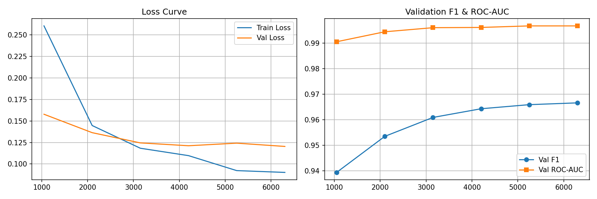
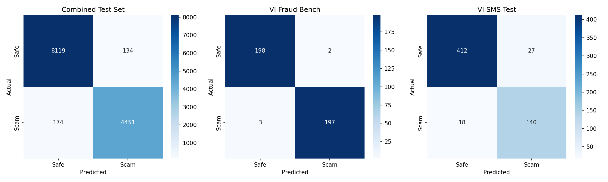

# 🛡️ AI Scam Shield — Multilingual Scam & Phishing Detection

Hệ thống phát hiện tin nhắn và liên kết lừa đảo đa ngôn ngữ (**Tiếng Việt & Tiếng Anh**) sử dụng **XLM-RoBERTa (`xlm-roberta-base`)**, bao gồm:
* **Web Application (`web_scamm/`)**: Backend **FastAPI + SQLAlchemy (JWT Auth)** và Frontend **React + Vite + TailwindCSS**.
* **Training & ETL Pipeline (`notebooks/`)**: Notebook xử lý ~34.25M dòng `Data_Preprocessing.zip` kết hợp các bộ dữ liệu SMS/Email/VI Fraud và huấn luyện mô hình v2.
* **Model Weights (Hugging Face Hub)**: Trọng số `XLM-RoBERTa v2` được lưu trữ tại [`bangta/Scam-detection`](https://huggingface.co/bangta/Scam-detection) (tự động tải khi chạy ứng dụng, không cần Git LFS).
* **Telegram Bot (`fraud_bot/`)**: Module bot Telegram tham khảo (phiên bản PhoBERT v1; các checkpoint PhoBERT cũ được lưu tại nhánh `archive-v1-phobert`).

---

## 📊 Hiệu năng Mô hình XLM-RoBERTa (v2)

Đánh giá từ [`reports/v2/system_performance_report.json`](./reports/v2/system_performance_report.json) với ngưỡng hiệu chỉnh `threshold = 0.69`, `max_length = 128`:

| Bộ đánh giá | Accuracy | Precision | Recall | F1-Score | ROC-AUC |
|---|---:|---:|---:|---:|---:|
| **Combined Test (12,878 mẫu)** | **97.61%** | **97.08%** | **96.24%** | **96.66%** | **99.65%** |
| TF-IDF + LogReg Baseline (Combined Test) | 96.03% | 95.17% | 93.71% | 94.43% | 99.18% |
| **VI Fraud Bench (400 mẫu tiếng Việt)** | **98.75%** | **98.99%** | **98.50%** | **98.75%** | **99.92%** |
| **VI SMS Test (597 mẫu)** | **92.46%** | **83.83%** | **88.61%** | **86.15%** | **96.57%** |
| **100-Sample Realistic Benchmark** | **98.00% (`98/100`)** | — | — | **98.04%** | — |

<p align="center">
  
  
</p>

---

## 📂 Cấu trúc Repository

```text
├── web_scamm/                         # Ứng dụng Web AI Scam Shield (Full-stack)
│   ├── backend/                       # FastAPI, SQLite/SQLAlchemy, JWT Auth, XLM-RoBERTa Inference
│   ├── frontend/                      # React + Vite Dashboard, Detect, Analytics, History, Settings
│   ├── scripts/                       # download_model.py & upload_to_hf.py (Hugging Face Hub)
│   ├── docker-compose.yml             # Triển khai Docker Backend + Frontend
│   └── README.md                      # Hướng dẫn cài đặt chi tiết cho Web App
├── notebooks/                         # Notebook ETL & Fine-tuning
│   ├── telegram_etl_pipeline.ipynb    # ETL dữ liệu Telegram
│   ├── scam_detection_training_v1.ipynb # Thử nghiệm PhoBERT v1
│   └── train_scam_shield_v2.ipynb     # Pipeline huấn luyện XLM-RoBERTa v2 (Kaggle)
├── reports/v2/                        # Báo cáo JSON & biểu đồ đánh giá mô hình v2
├── checkpoints_results/               # Biểu đồ tham khảo từ giai đoạn v1
└── fraud_bot/                         # Telegram Bot phát hiện lừa đảo
```

---

## 🚀 Hướng dẫn Khởi chạy Nhanh (Web App `web_scamm/`)

```powershell
git clone https://github.com/tabang205/Scam-detection.git
cd Scam-detection\web_scamm
```

### 1. Chạy Backend (FastAPI — Python 3.11 / 3.12)
```powershell
python -m venv venv
.\venv\Scripts\Activate.ps1
pip install -r backend\requirements.txt
copy .env.example .env

# Tùy chọn: tải trước trọng số từ Hugging Face (hoặc backend tự tải khi gọi /api/detect lần đầu)
python scripts\download_model.py

cd backend
python -m uvicorn app:app --reload --host 127.0.0.1 --port 8000
```

### 2. Chạy Frontend (React + Vite)
```powershell
cd web_scamm\frontend
npm install
npm run dev
```

* **Frontend**: `http://localhost:5173`
* **API Docs (Swagger)**: `http://localhost:8000/docs`
* **Docker Compose**: xem thêm tại [`web_scamm/README.md`](./web_scamm/README.md).
