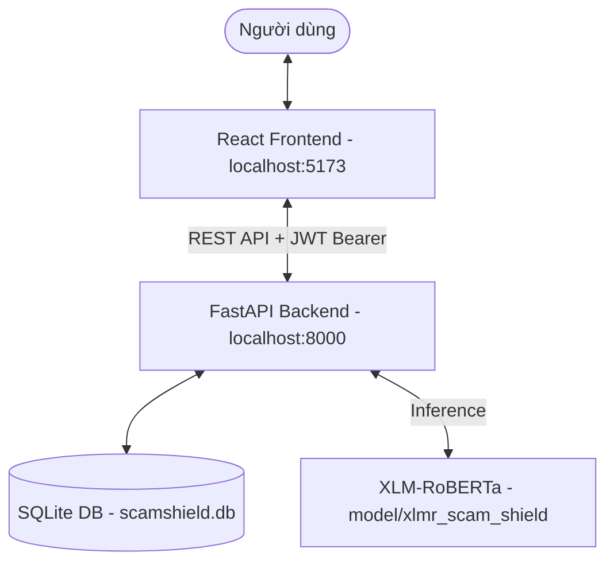

# Tổng Quan Dự Án AI Scam Shield

**AI Scam Shield** là nền tảng phát hiện và giám sát lừa đảo đa ngôn ngữ (Tiếng Việt & Tiếng Anh) dựa trên Trí tuệ Nhân tạo (AI). Hệ thống sử dụng mô hình Transformer **XLM-RoBERTa (`xlm-roberta-base`)** được fine-tune trên dữ liệu Telegram, SMS, Email và bộ benchmark lừa đảo Việt Nam, kết hợp với tầng trích xuất từ khóa ranh giới từ (`word-boundary regex`) để giải thích tín hiệu nguy cơ theo thời gian thực.

---

## 1. Kiến Trúc Hệ Thống (Architecture Overview)

Dự án được xây dựng theo mô hình **Client-Server**:
*   **Frontend**: Ứng dụng SPA viết bằng **React** + **Vite** + **TailwindCSS**, giao diện Dark Mode tích hợp biểu đồ tương tác và đồng bộ trực tiếp với API backend.
*   **Backend**: API server **FastAPI**, xác thực **JWT Bearer Token** cho toàn bộ route nghiệp vụ, nạp trực tiếp trọng số **PyTorch + HuggingFace `transformers` (`safetensors`)** cho suy luận.
*   **Cơ sở dữ liệu**: **SQLite** (`backend/scamshield.db`) quản lý qua **SQLAlchemy ORM**, tách biệt dữ liệu quét (`scan_history`) theo `user_id` của từng tài khoản.

---

## 2. Dữ Liệu Huấn Luyện & Hiệu Năng Mô Hình (v2)

Mô hình được huấn luyện trên Kaggle (2x Tesla T4 GPU) từ các nguồn dữ liệu đầy đủ gồm:
*   Toàn bộ **35 phân mảnh (`34,245,696` dòng thô)** của tập `Data_Preprocessing.zip` (sau khi lọc trùng scam và cân bằng mẫu clean đa ngôn ngữ + tiếng Việt).
*   `ngovanhh/vi-fraud-bench-vi`, `tuan251209/vietnamese-sms-dataset`, `uciml/sms-spam-collection-dataset`, và `naserabdullahalam/phishing-email-dataset`.

Kết quả đánh giá ghi nhận trong `backend/output/system_performance_report.json`:
*   **Combined Test Set (12,878 mẫu)**: Accuracy `97.61%`, Precision `97.08%`, Recall `96.24%`, F1-Score `96.66%`, ROC-AUC `99.65%`.
*   **VI Fraud Bench (400 mẫu tiếng Việt)**: Accuracy `98.75%`, Precision `98.99%`, Recall `98.50%`, F1 `98.75%`.
*   **VI SMS Test (597 mẫu)**: Accuracy `92.46%`, F1 `86.15%`.
*   **100-Sample Realistic Benchmark**: `98/100` (`98.0%`, F1 `0.9804`, ngưỡng hiệu chỉnh `threshold = 0.69`).

---

## 3. Các Chức Năng Chính (Core Features)

### 🔑 Quản Lý Tài Khoản & Phân Quyền Dữ Liệu (Authentication)
*   **Đăng ký & Đăng nhập**: Chuẩn hóa email lowercase (`strip().lower()`), kiểm tra độ dài tên và giới hạn bcrypt 72-byte UTF-8.
*   **Bảo vệ bằng JWT**: Tất cả endpoint `/api/detect`, `/api/history`, `/api/analytics` yêu cầu `Authorization: Bearer <token>` và cô lập dữ liệu theo `current_user.id`. Khi token hết hạn (`401`), frontend tự động đăng xuất và điều hướng về `/login`.

### 🔍 Động Cơ Phát Hiện Thời Gian Thực (Real-Time Detection Engine)
*   **Tiền xử lý đồng nhất training-inference (`preprocess_service.py`)**: Chuyển URL thành token `[url]` giữ lại token tên miền (ví dụ `http://csgt-tracuuphat.com` -> `[url] csgt tracuuphat com`) và tách từ nối gạch dưới (`_`).
*   **Suy luận AI (`model_service.py`)**: Dùng `AutoTokenizer` + `AutoModelForSequenceClassification` với `max_length = 128` và ngưỡng tối ưu từ `threshold.json` (`0.69`), chạy FP16 trên CUDA hoặc FP32 trên CPU, hỗ trợ thread-safe lazy loading.
*   **Rút trích từ khóa giải thích (`keyword_service.py`)**: Đối chiếu bằng compiled regex ranh giới từ `(?<!\w)...(?!\w)` để không nhầm lẫn chuỗi con trong từ vô hại (chỉ trả từ khóa cảnh báo khi kết quả là `Scam`).
*   **Thang đo mức độ đe dọa (`helpers.py`)**: Ánh xạ `confidence` & nhãn dự đoán sang `High` / `Medium` / `Low`.

### 📊 Dashboard, Analytics & Security Logs
*   **Dashboard & Analytics**: Thống kê thực tế từ DB của người dùng theo bộ lọc khung thời gian (`days` = 1 / 7 / 30 ngày), biểu đồ theo giờ/theo ngày, top từ khóa vi phạm thực tế, nhật ký cảnh báo gần đây và độ chính xác từ báo cáo mô hình thật (`system_performance_report.json`). Cho phép tải báo cáo JSON.
*   **History Logs**: Tìm kiếm full-text, lọc `Scam` / `Safe`, sắp xếp (`newest`, `oldest`, `confidence`), và phân trang.
*   **Settings**: Lưu cấu hình giao diện & ngưỡng cảnh báo vào `localStorage`.

---

## 4. Tổ Chức Mã Nguồn (Directory Structure)

### 📂 Thư mục Backend (`backend/`)
*   `app.py`: Điểm khởi chạy FastAPI, cấu hình CORS, logging, Health Check (`/api/health`) và các router API.
*   `requirements.txt`: Khai báo dependencies (`fastapi`, `torch`, `transformers`, `safetensors`, `sqlalchemy`, `passlib`, `bcrypt`, `httpx`, v.v.).
*   `api/`: `auth.py`, `detect.py`, `history.py`, `analytics.py`.
*   `database/`: `db.py`, `models.py` (`User`, `ScanHistory`), `schemas.py` (Pydantic v2 `ConfigDict`).
*   `services/`: `detect_service.py`, `model_service.py`, `preprocess_service.py`, `keyword_service.py`.
*   `utils/`: `config.py`, `helpers.py`.
*   `tests/test_api_workflow.py`: Bộ kiểm thử tự động tiền xử lý, từ khóa, Auth/JWT và cô lập dữ liệu user.
*   `output/system_performance_report.json`: Báo cáo đánh giá mô hình dùng cho trang Analytics.

### 📂 Thư mục Model (`model/xlmr_scam_shield/`)
*   `model.safetensors`, `config.json`, `tokenizer.json`, `tokenizer_config.json`, `threshold.json`.

### 📂 Thư mục Frontend (`frontend/`)
*   `src/services/`: `config.js` (Axios interceptor + `auth:expired`), `api.js`.
*   `src/context/`: `AuthContext.jsx`, `ToastContext.jsx`.
*   `src/hooks/`: `useDetect.js`.
*   `src/pages/`: `DashboardPage.jsx`, `DetectPage.jsx`, `AnalyticsPage.jsx`, `HistoryPage.jsx`, `SettingsPage.jsx`, `LoginPage.jsx`, `RegisterPage.jsx`.

---

## 5. Hướng Dẫn Khởi Chạy Nhanh

Xem chi tiết hướng dẫn chạy local (Windows/venv) và Docker tại [README.md](./README.md).
