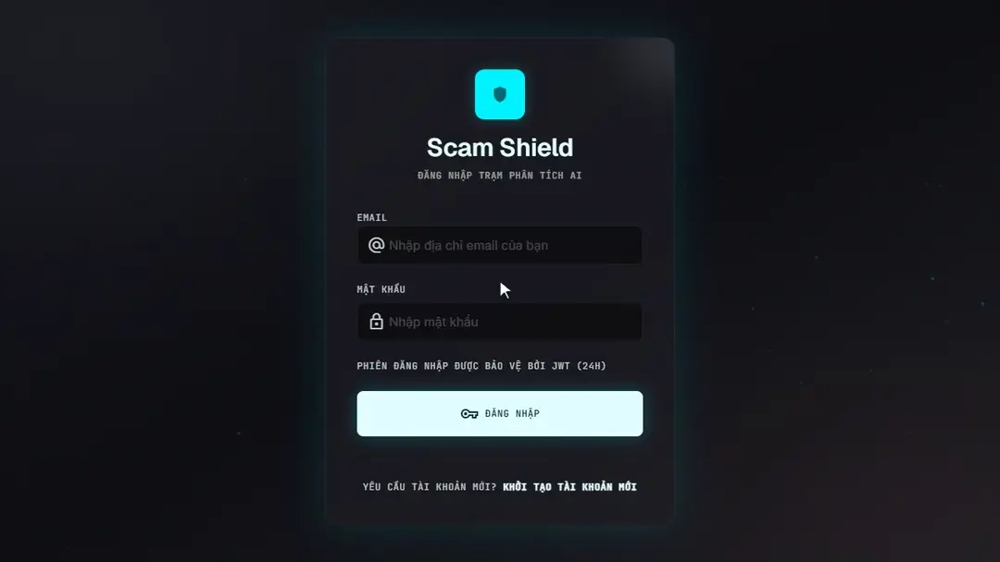

# Hướng dẫn Khởi chạy Dự án AI Scam Shield

Dự án gồm hai phần chính: **Backend (FastAPI)** vận hành mô hình AI **XLM-RoBERTa** (`model/xlmr_scam_shield/`) và **Frontend (React + Vite)** hiển thị giao diện phân tích, thống kê và nhật ký quét theo từng tài khoản (JWT).

<p align="center">
  
</p>

> *Fallback GIF*: [assets/demo.gif](assets/demo.gif)

---

## 1. Khởi chạy Backend (FastAPI)

Mở một cửa sổ Terminal/PowerShell mới và thực hiện các lệnh sau:

1. **Di chuyển vào thư mục gốc của dự án**:
   ```powershell
   cd D:\Project_DeepLearning\web_scamm
   ```

2. **Kích hoạt Môi trường ảo Python (venv — Python 3.11/3.12)**:
   - Trên **PowerShell**:
     ```powershell
     .\venv\Scripts\Activate.ps1
     ```
   - Trên **Command Prompt (CMD)**:
     ```cmd
     .\venv\Scripts\activate.bat
     ```

3. **Cài đặt thư viện & cấu hình môi trường**:
   ```powershell
   pip install -r backend\requirements.txt
   copy .env.example .env
   ```
   *(Trọng số AI `XLM-RoBERTa` được host tại [`bangta/Scam-detection`](https://huggingface.co/bangta/Scam-detection). Nếu thư mục `model/xlmr_scam_shield/` chưa có sẵn trên máy, backend sẽ tự động tải về ở lần chạy đầu tiên; hoặc tải trước thủ công bằng `python scripts/download_model.py`).*

4. **Khởi chạy máy chủ FastAPI**:
   ```powershell
   cd backend
   python -m uvicorn app:app --reload --host 127.0.0.1 --port 8000
   ```
   *Lưu ý: Mô hình `XLM-RoBERTa` tại `model/xlmr_scam_shield/` (`model.safetensors`, `threshold.json`) được lazy-load ở lần gọi `/api/detect` đầu tiên để tối ưu thời gian khởi động server.*

---

## 2. Khởi chạy Frontend (React + Vite)

Mở một cửa sổ Terminal/PowerShell **mới thứ hai** và thực hiện các lệnh sau:

1. **Di chuyển vào thư mục frontend**:
   ```powershell
   cd D:\Project_DeepLearning\web_scamm\frontend
   ```

2. **Cài đặt thư viện** (chỉ cần chạy ở lần đầu tiên hoặc khi có thay đổi file `package.json`):
   ```powershell
   npm install
   ```

3. **Khởi chạy môi trường phát triển (Development Server)**:
   ```powershell
   npm run dev
   ```

4. **Truy cập ứng dụng**:
   Mở trình duyệt tại đường dẫn hiển thị trong terminal (mặc định: `http://localhost:5173`).

---

## 3. Chạy kiểm thử Backend & Frontend

- **Kiểm thử API / Auth / Tiền xử lý Backend**:
  ```powershell
  .\venv\Scripts\python.exe backend\tests\test_api_workflow.py
  ```
- **Kiểm tra Lint & Build Frontend**:
  ```powershell
  cd frontend
  npm run lint
  npm run build
  ```

---

## 4. Chạy bằng Docker Compose (tùy chọn)

```powershell
python scripts/download_model.py
docker compose up --build
```
*(Khuyến nghị đặt `SECRET_KEY` riêng trong `.env` trước khi chạy production; nếu chưa có `model/xlmr_scam_shield/` sẵn khi build Docker, container backend vẫn có thể tự tải từ `HF_MODEL_REPO=bangta/Scam-detection` lúc khởi động suy luận đầu tiên).*

---

## Các thông tin cấu hình cổng mặc định
- **Backend API**: `http://localhost:8000` (Tài liệu Swagger tại `http://localhost:8000/docs`, Health Check tại `http://localhost:8000/api/health`).
- **Frontend App**: `http://localhost:5173`.
